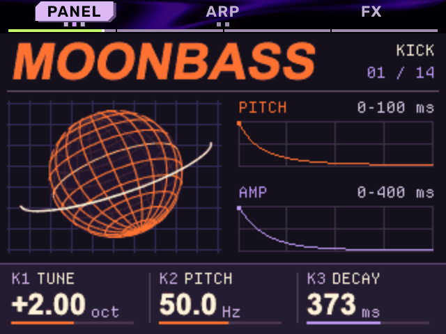

# MoonBass

An analog-style kick drum synthesizer as a CLAP plug-in, built for the Akai MPC Sample running Melodee (64-bit ARM
Linux, Cortex-A55). Hosts list it as **hdslave MoonBass** (id `com.hdslave.moonbass`). It follows the Jomox ModBase 09
(Mk I and Mk II) and MBase 11: their eight knobs, and every parameter their menus, second functions and LED pages
hide. Orbital Impact puts them on the MPC Sample’s screen, three to a page.

One voice, played by notes (pads, keys, the host's sequencer) or its Play button, as the hardware is played by MIDI.

## Signal flow

```
note / Play ──► gate (Gate Time) ──► VCO phase starts at 0, the VCA opens and is held for the gate
Pitch (+ key: Split Mode, Pitch Mode) + Tune × pitch envelope + LFO 1/2 ──► VCO: sine ──Harmonics──► cusped wave
gate ──► Pulse (its edge through a coupling high pass) ─┐
gate × (Metal Noise 1 + Metal Noise 2) ──► Noise ───────┴──► Attack ─┐
VCO ──► VCA (held for the gate, then Decay; Compression cuts the tail) ─┴──► EQ (one-pole low pass) ──► Volume ──► out (stereo)
CV 1-4 In × Amt ──► any of 16 destinations          velocity (Dynamics) × Accent × the gate's charge ──► level
```

## Orbital Impact

In hdslaveOS, MoonBass draws a wireframe moon on Melodee’s Edit and Stage plug-in pages. A kick briefly flattens the mesh. The orange graph previews the first 100 ms of pitch sweep above the resting note. The violet graph shows the gate hold and amplitude decay, including the effect of Compression. Both graphs follow the patch and its CV settings. The amplitude graph’s time scale changes for long tails.



Press the encoder to play a kick from any page. Minus and Plus change pages. Turn K1–K3 to change the three displayed parameters. The wheel also adjusts K1, with fine increments on continuous parameters when a shifted wheel event reaches the page. A hollow mark under a value shows where its physical pot sits before pickup. [One kick captured in Melodee](docs/orbital-hit.gif)

The interface uses Departure Mono by Helena Zhang. [Font license](licenses/OFL-departure-mono.txt)

## Pages

MoonBass groups its 42 parameters into 14 pages. On page 4 the third slot shows the Play button, operated by pressing the encoder.

| Page | Section | K1 | K2 | K3 |
|---|---|---|---|---|
| 1 | Kick | Tune | Pitch | Decay |
| 2 | Kick | Harmonics | Pulse | Noise |
| 3 | Kick | Attack | EQ | Volume |
| 4 | Kick | Gate Time | Compression | Play |
| 5 | Noise | Metal Noise 1 | Metal Noise 2 | Noise 2 Mask |
| 6 | LFO 1 | LFO 1 Wave | LFO 1 Speed | LFO 1 Int |
| 7 | LFO 1 | LFO 1 Dest | LFO 1 Mode | LFO 1 Clock |
| 8 | LFO 2 | LFO 2 Wave | LFO 2 Speed | LFO 2 Int |
| 9 | LFO 2 | LFO 2 Dest | LFO 2 Mode | LFO 2 Clock |
| 10 | Play | Split Mode | Pitch Mode | Dynamics |
| 11 | CV 1 | CV 1 Dest | CV 1 Amt | CV 1 In |
| 12 | CV 2 | CV 2 Dest | CV 2 Amt | CV 2 In |
| 13 | CV 3 | CV 3 Dest | CV 3 Amt | CV 3 In |
| 14 | CV 4 | CV 4 Dest | CV 4 Amt | CV 4 In |

Pages 1-3 are the panel's knobs in the hardware's order. Pages 6 and 8 put each LFO's wave, speed and intensity in the
order the ModBase 09's lower knobs give them as a second function.

## Controls

The hardware's names and where each lives on it. MBase 11 values run 000-255, the ModBase 09's 000-252, and MoonBass
gives units where the manuals give them.

| MoonBass | MBase 11 | ModBase 09 (Mk I, Mk II) | Range |
|---|---|---|---|
| Tune | Tune (knob) | Tune (knob) | +0 – +4 octaves: the pitch envelope's depth (attack 0, a fixed 20 ms decay). High: the 909's kick in the gut; low: softer, 808-like kicks and bass tones |
| Pitch | Pitch (knob) | Pitch (knob) | 10 Hz – 175 Hz: where the VCO settles once Tune's envelope has gone |
| Decay | Decay (knob) | Decay (knob) | 30 ms – 2 s (the VCA's time to -60 dB, after the gate) |
| Harmonics | Harmonics (knob) | Harmonics (knob) | 0 – 100 %: the sine bent toward a cusped (parabolic-segment) wave: harder, timpani-like, not a distortion |
| Pulse | Pulse (knob) | Pulse (knob) | 0 – 100 %: the click: the gate's edge through a coupling high pass, so Gate Time shapes it |
| Noise | Noise (knob) | Noise (knob) | 0 – 100 %: the noise during the gate (Metal Noise 1 + 2) |
| Attack | Attack (knob) | Attack (knob) | 0 – 100 %: the level of Pulse and Noise together; at 0 neither sounds |
| EQ | EQ (knob) | EQ (knob) | 0 – 100 %: a one-pole ("flat slope") low pass over everything, open (20 kHz) to closed (150 Hz) |
| Volume | Volume (menu) | Volume (green menu) | 0 – 100 % |
| Gate Time | Gate (menu) | Gate Time (orange menu) | 0.1 – 16 ms: the trigger pulse. Short: a bright click, less energy in the envelope; long: a clappy attack with the noise clear |
| Compression | Compr (menu) | Compression (red menu) | 0 – 100 %: lowers the decaying envelope; high, the tail is cut to a short click |
| Play | Play button | Play button | plays the kick at full velocity, at Pitch |
| Metal Noise 1 | MetNze (menu): 000 noise, 001-255 patterns | Metal Noise 1 (orange): off, noi, 2-499 | Off / Noise (white) / 2 – 499: metallic patterns, each number its own sound |
| Metal Noise 2 | — | Metal Noise 2 (red): off-499 | Off / 1 – 499: a more periodic, tone-like pattern; it adds to Metal Noise 1 |
| Noise 2 Mask | — | Bit Mask 2 (red, blinking): M01-M16 | M01 – M16: low, very high pitched; high, long periodic patterns. Up to M09 a number with no bit inside the mask is silent; from M10 each mask is slower again (M16: patterns up to 3.3 s long) |
| LFO 1 Wave | LFO Wave (menu): 8 waves | LFO 1 Wave (knob 5, 2nd function): 16 | Saw Up, Saw Down, Sine, Sine -, Triangle, Triangle -, Square, Square -, Pulse 60/70/80/88/40/30/20/12 (the % of a cycle on top) |
| LFO 1 Speed | LFO Speed (menu): 041-290 BPM | LFO 1 Speed (knob 6, 2nd function) | 0.1 – 40 Hz, while Clock is Free |
| LFO 1 Int | LFO Int (menu) | LFO 1 Int (knob 7, 2nd function) | 0 – 100 %: up to ±2 octaves on Pitch, or ±128 patterns on Metal Noise 1 (it moves the number: from Noise into the patterns and back, never to Off). 0 turns it off |
| LFO 1 Dest | — (pitch only) | LFO 1 Destination: LM1 / no1 | Pitch / Metal Noise 1 |
| LFO 1 Mode | LFO Sync (FrE/SYn) + LFO One Shot (2nd function) | — (always restarts on the gate) | Free: runs on; Retrigger: starts again at each hit (a second pitch envelope); One Shot: one cycle from each hit, then holds where the cycle ends |
| LFO 1 Clock | LFO Speed "Mid": MIDI clock | — | Free (Speed) / 2/1 … 1/32 with triplets: a cycle a note value at the host's tempo. With Mode Free it keeps in step with the song's beats (a cycle starts on each multiple from the top) |
| LFO 2 … | — | LFO 2 (red page): the same | as LFO 1 |
| Split Mode | Split Mode: SM1 (C1), SM2 (C1-F3) | Split Mode: SM1 (C1), SM2-SM4 (C1-C2, C2-C3, C3-C4), SM5 (C1-C6) | Any Note (new: every key plays the kick as set) / C1 / C1-C2 / C2-C3 / C3-C4 / C1-C6 / C1-F3. Keys outside the range don't play; inside it, the pitch counts up from its lowest key |
| Pitch Mode | Pitch Mode: Lin / SEM | — (not in exact semitones) | Linear: equal steps in Hz, a semitone's at the bottom / Semitones |
| Dynamics | — (velocity up to Volume) | Trig Dynamics d01-d63 (for the Trig input) | 0 – 100 %: how far velocity sets the level; 0, every hit at full level |
| CV n Dest | — | CV 1-4 Dest (orange) | Off, Tune, Pitch, Decay, Harmonics, Pulse, Noise, Attack, EQ, Compression, Metal Noise 1, Metal Noise 2, LFO 1 Rate, LFO 1 Int, LFO 2 Rate, LFO 2 Int, Accent |
| CV n Amt | — | CV 1-4 Amt (red): -128 – 127 | -128 – +127: 5 V at +127 adds nearly the destination's whole range; negative subtracts |
| CV n In | — | the CV 1-4 jacks (0-5 V) | 0 – 5 V: the jack's voltage, for the host to automate (a motion lane, a knob) |

### Taken at the hit

As on the hardware (its CV list marks them "not realtime": the analog circuit takes them when it is triggered), a hit
takes **Tune, Decay, Pulse, Noise, Attack, Metal Noise 1 and 2, Noise 2 Mask and Gate Time** as they are when it
starts, from a knob or a CV alike. Changing one is heard from the next hit. **Pitch, Harmonics, EQ, Compression, Volume
and the LFOs** move while a kick sounds.

### Notes and velocity

A note plays the kick if Split Mode takes its key. A note off does nothing: Gate Time is the gate. The level is the
velocity as far as Dynamics lets it, times the Accent CV, times the gate's charge (a short gate puts less into the
envelope). A new hit restarts the VCO's phase and the envelopes over whatever still sounds, as one voice does.

Two hits on one frame are one hit: the louder plays as if it had come alone, its key, pitch and level with it (equal,
the later). Melodee gives all of a block's MIDI its first frame, so two pads struck together, a pad over the sequence
or a 35 and 36 pair land on one frame; a ghost note there no longer takes the accent's level, or (with a Split Mode)
its pitch. A frame apart, both play.

A choke stops the hit its key played, on its frame (a choke of any key, -1, stops whatever plays), and so does MIDI's
All Sound Off (CC 120 at 0). Melodee sends both when it silences a track.

- **Any Note** (the default) suits a drum track: every pad plays the kick as set.
- **C1-C2** with **Linear** is the ModBase 09's way: the eight pads of a Melodee drum track (notes 36-43) play eight
  tunings of one kick.
- **C1-F3** with **Semitones** and a long Decay is the MBase 11's way to play bass lines.

### CV inputs

The ModBase 09's four programmable CV inputs, each routed to one destination with its own amount. Several on one
destination add. CV n In is the jack: automate it in the host to play the patch cable's part. Accent (CV 1 only on
the hardware, any CV here) raises a hit's level up to about twice, or lowers it with a negative amount. The Mk II's
ACC jack does the same, as velocity.

### MIDI controllers

The hardware's controller map works too (any channel: the host's track is the channel). A controller sets its
parameter as turning it would, and MoonBass tells the host the new value.

| CC | Parameter | | CC | Parameter |
|---|---|---|---|---|
| 100 | Tune | | 114 | Gate Time |
| 101 | Pitch | | 115 | Metal Noise 1 (0 Off, 1 Noise, 2-127 over 2-499) |
| 102 | Decay | | 116 | Metal Noise 2 (0 Off, 1-127 over 1-499) |
| 103 | Harmonics | | 117 | Volume |
| 104 | Pulse | | 119 | LFO 1 Wave (0-15) |
| 105 | Noise | | 120 | Noise 2 Mask (1-15: M02-M16) |
| 106 | Attack | | 121 | LFO 1 Int (1-127) |
| 107 | EQ | | 122 | LFO 1 Speed |
| 113 | Compression | | 123 | LFO 2 Wave (1-15) |
| | | | 124, 125 | LFO 2 Int, LFO 2 Speed |

That is the ModBase 09's map. The MBase 11 shares 100-117 but uses 120 for LFO Sync and 123 for LFO One Shot. Those
two are left to the ModBase 09's meaning.

120, 121 and 123 at 0 are kept for what MIDI makes them: All Sound Off (it stops the kick), Reset All Controllers and
All Notes Off (nothing to do). Hosts send them on stop and panic, and Melodee sends them on every channel when it
silences a track, so they must never move a parameter. Through the map those three reach their values from 1 up
(Noise 2 Mask M02 and above, LFO 1 Int from 1/127, LFO 2 Wave from Saw Down).

## Presets

Ten factory presets, inside the plug-in: Melodee lists them on the plug-in's PRESETS page (any host with CLAP preset
discovery does). A preset sets every parameter; Default puts everything back (the ModBase 09's Preset Init).

| Preset | What it is |
|---|---|
| Default | A plain kick at 50 Hz, Tune two octaves, a short click |
| Gut Punch | High Tune, a short gate and hard click, a little Compression: tight and punchy |
| Soft Boom | Low Tune, the EQ mostly closed, a long decay: soft and round, 808-like |
| Sub Drop | 30 Hz, the longest decays, a falling sweep |
| Clap Kick | A long gate with loud noise through an open EQ: a wet, clappy attack |
| Metal Kick | Both metal noise generators (337 and 77, mask M12) in a long gate |
| Wobble Tail | A long tail with LFO 1 on Pitch, a sine at 1/16 in step with the song |
| Zap | LFO 1 as a one-shot Saw Down on Pitch: the tail drops away |
| Bass Line | Split C1-F3 in Semitones from C1 (32.7 Hz), Harmonics up, a long decay: play it from the keys |
| Pad Tunings | Split C1-C2, Linear: each pad of a drum track a different tuning |

They are the patches the demo renders play: the tests load each preset and check it gives the same values and the
same samples as the demo's list.

## Where values were inferred

The manuals give the parameters, their order and what they do, and some ranges (Pitch 10-175 Hz, Decay up to 2 s,
Gate Time 0.1-16 ms, the MBase 11's LFO at 41-290 BPM). The rest is chosen to match what they describe:

- Tune: up to 4 octaves above Pitch, its envelope's fixed decay 20 ms.
- Decay's short end: 30 ms.
- EQ: a one-pole low pass from 20 kHz to 150 Hz.
- Harmonics: the cusped wave (parabola segments, harmonics falling as 1/n²) at the sine's fundamental level.
- Pulse: the gate through a 150 Hz coupling high pass; the gate's edges take about 25 µs.
- Compression: a threshold, up to 90 % of the peak, taken off the falling envelope and scaled back to full.
- The gate's charge: 60 % of the level at the shortest gate, rising to 100 % at 16 ms (85 % by 2 ms).
- Metal noise: the manuals describe what the patterns are like, not how they are made. Metal Noise 1's numbers switch
  on, by their bits, nine square waves at unrelated frequencies (587 Hz – 7.95 kHz) combined by exclusive-or. Metal
  Noise 2 is the parity of a 16-bit counter clocked at 20 kHz, ANDed with the number and the mask; from M10 up, the
  number (nine bits) moves into the mask's top bits, so every mask is its own sound and the wider ones reach the
  counter's slower bits. Both behave as the manual says (with a small mask, a number with no bit in it is silent and
  numbers differing only above it sound alike), but they are not the hardware's patterns.
- LFOs: Speed 0.1-40 Hz; Int up to ±2 octaves, or ±128 patterns on Metal Noise 1. The manuals disagree on which way
  the square starts (MBase 11: from the top; ModBase 09: from the bottom); Square starts from the top, Square - from
  the bottom.
- Pitch Mode Linear: each key adds a semitone's worth of Hz at the bottom of the range.
- CV scaling: 5 V at ±128 is the destination's whole range; Accent at most doubles the level.

The ModBase 09 Mk II's own manual (17 MB) could not be fetched. Its additions are from Jomox's product page: the ACC
input (an accent/velocity CV, here Accent and velocity) and a firmware that removes parameter jumps and glitches.

## Left out

- The MBase 11's linked attack: on it, setting Pulse or Noise to 0 also stops the other. The ModBase 09 dropped
  that, and so does MoonBass.
- The audio trigger input (X Trig In / Trig: its level, on/off and sensitivity), the gate input and Gate Mode, and the
  LIN FM input: a plug-in instrument has no jacks. Notes stand in for the gate. Trig Dynamics became Dynamics, for
  velocity.
- Bus Vol, Bus Send and Bus Env (the Jomox inter-module bus), MIDI channel (the host's track is the channel), Store,
  SysEx dumps and the 100 factory sounds (host presets stand in for them; the factory sounds aren't public).

## Cost

One voice at the host's rate. Instructions a 128-frame block takes, from `tools/bench.sh` (callgrind):

| Case | Instructions | Share of one A55 core at 1 instruction a cycle |
|---|---|---|
| Everything busy (a hit every 13 ms with the longest gate, so the attack never rests: both metal noises, both LFOs, Harmonics, Compression) | about 70,000 | 1.5 % |
| The default kick on every beat at 120 BPM | about 23,000 | 0.5 % |
| Stopped | about 530 | 0.01 % |

The attack section only runs for the gate and the moment after it. Once a kick has died away nothing runs at all:
the LFOs' places are worked out from the time, so they need no ticking over. With Compression at 0 the VCA needs no
division (a division is about 10 of the A55's cycles, more than its one instruction suggests), and the EQ's
coefficient is only worked out while the EQ is moving. The build with Orbital Impact is 195 KiB stripped.

## Build and test

Needs Docker with a Linux arm64 context (Melodee's `colima-melodee` and its `melodee-builder` image by default).

```sh
./build.sh          # build/MoonBass.clap, then the tests (tests/host.cpp), the sound's fingerprint and demo renders build/demo-*.wav
./build.sh bench    # build/bench
tools/bench.sh      # instruction counts (Melodee's melodee-profiler image)
```

The tests load the plug-in through the CLAP API and check (about 465,000 checks):
- the description, its features and ports;
- every parameter's range, default and text both ways, its page (three to a page, one section each) and the documented
  range ends;
- the screen’s 14 sets of knob bindings, pitch and amp graphs, pot pickup, host edits, audition wakeup, expiry of old presses, hit animation and idle redraws;
- state save and load (and another version's state);
- the presets, as preset discovery lists them and preset-load loads them;
- hits landing on their frame at 44.1, 48 and 96 kHz and block sizes 1, 37, 128 and 4096;
- the same output to the bit whatever the block size, with knobs, controllers, LFOs, CVs and Play moving;
- the host's reset giving the same output as a fresh instance;
- the sound's parts:
  - Pitch's frequency at both ends;
  - Tune's sweep;
  - Decay's -60 dB time;
  - Compression shortening the tail;
  - Harmonics' overtones;
  - EQ;
  - the attack's parts, its length and the gate's, to the frame;
  - the metal noises' rules (off, silent masks, numbers alike above the mask, M01's 10 kHz, M09-M16 each its own and
    slower);
- which parameters a hit takes at its start and which move while it sounds;
- each Split Mode's keys and Pitch Mode's steps;
- Dynamics, MIDI notes and Play;
- two hits on one frame, either order (the louder plays as if alone, to the bit, at block sizes 1-4096), and a frame
  apart (both play);
- chokes (the hit's own key, any key, another key's) and All Sound Off;
- the LFOs:
  - Int 0 doing nothing;
  - a square's two pitches;
  - Retrigger against Free;
  - One Shot holding;
  - a synced LFO changing on the beat, staying in step through a new tempo, and lining up after a jump;
  - LFO 2 on Metal Noise 1;
- the CVs (each the same as turning its knob, adding, Accent, taken at the hit or not);
- every MIDI controller in the map, and 120, 121 and 123 at 0 (as Melodee sends them) moving nothing;
- tempos that are infinite, NaN, 0 or absurd: the output stays a number and the kick ends in silence;
- finite, bounded output at 64 random and extreme settings, hit fast and slow.

`tests/fingerprint.cpp` then renders 64 fixed scenarios:
- each preset;
- the bench's patches;
- 24 random patches with notes, Play, controllers and knobs moving;
- other block sizes and rates;
- the LFOs against a song that stops, jumps and loops;
- every LFO wave in each mode;
- the CVs on every destination;
- the MIDI map.

It hashes every output sample's bits against `tests/fingerprint.txt`. Work meant to keep the sound, such as a
speed-up, must leave every hash as it is. A change meant to change the sound updates them with
`make fingerprint-update` (run inside the build image). The hashes hold for Melodee's build image and these compiler
flags.

## Install

Copy `build/MoonBass.clap` to `Melodee/Plugins/hdslave/hdslave MoonBass.clap` on the card (or the staged card's
folder), then pick it on an empty track: Stage, Plugin, hdslave, hdslave MoonBass. It needs only libc and libm, glibc 2.35 or
newer (the MPC has 2.39).
