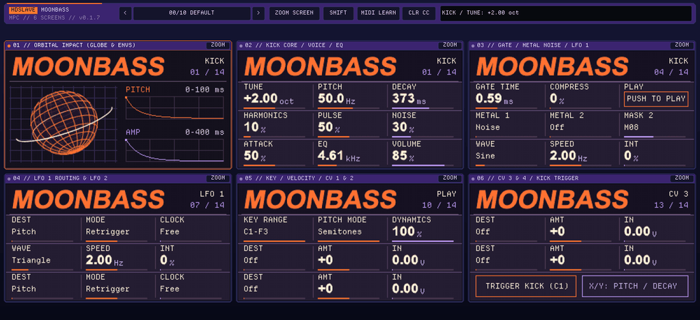

# hdslave MoonBass — macOS (and Windows) Desktop CLAP Plug-in

Separate desktop CLAP build of **hdslave MoonBass** for **FL Studio** (2024+) and any other CLAP host on macOS (Apple Silicon / Intel) and Windows (x64).



- **Multi-Screen MPC Dashboard:** displays all of hdslave MoonBass's native MPC screens simultaneously on one resizable Retina/HiDPI panel (with the hardware `K1`–`K3` footer panels removed) and direct mouse, trackpad, and touch control over every parameter, plot, sequencer, and pad.
- **Standalone from the MPC Sample build:** this directory is completely separate from the MPC Sample build in the repository root (`../src`, `../build.sh`). GitHub releases remain MPC Sample-only for now while the desktop builds are being finalized.

Version 0.1.8 has the MPC build's fix for an LFO in step with the song (Clock a note value, Mode Free): a place told
a little behind where it got to (a 64th note or less) holds it until the song is past it again, so no Square or Pulse
edge comes twice, and the place it counts from follows the place told, so a slow drift never builds up into a long
hold. Desktop hosts tell a straight place, so there it rarely mattered.

Version 0.1.7 brings the MPC build's hit shockwave to the Orbital Impact tile:
- a flash of the moon;
- a pressure wave that lights the grid;
- a blast in the plane of the moon's ring;
- sparks.

Its size follows velocity and Accent, and its length the Decay. Before 0.1.7 that tile never moved on a hit at all, not even the flattening: the panel paints its tiles whole every frame, and the page took every whole paint for a reopening. The tile now shows a hit unless the panel was shut since (no paint for a quarter of a second). `build-macos.sh` runs `tile_test`, which checks this through the inner plug-in.

Since 0.1.6, new instances and the Default preset start with **Key Range** at **C1-F3**. Key Range was called Split Mode before 0.1.7, and its **All Keys** choice Any Note; saved projects load unchanged.

## hdslave plug-in license

You may use these plug-ins to make, perform, record and sell music, including paid client work, without royalties or credit to hdslave. You may share complete, unchanged official releases for free with their notices intact. Selling the software, including it in a paid product or subscription, or distributing a modified version requires prior written permission from hdslave. Third-party components keep their own licenses. [Full plug-in license](../LICENSE.txt).

## Build & Install (macOS)

Requires Xcode Command Line Tools and CMake 3.20+ (Ninja optional):

```bash
cd mac-clap
./build-macos.sh
./install-macos.sh
```

`install-macos.sh` builds, ad-hoc signs, tests, and installs `MoonBass.clap` to `/Library/Audio/Plug-Ins/CLAP/` (pass `--user` to install to `~/Library/Audio/Plug-Ins/CLAP/`). Quit and reopen FL Studio after reinstalling so macOS reloads the updated bundle.

## Build (Windows x64)

```powershell
cd mac-clap
.\build-windows.ps1
```

Copy `build\windows\clap\Release\MoonBass.clap` to `C:\Program Files\Common Files\CLAP\`.
